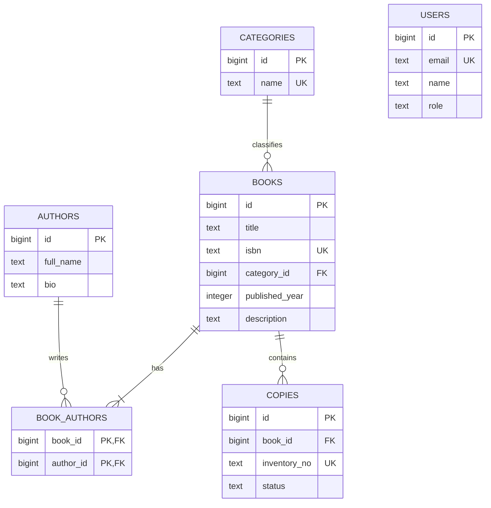

# 📚 LibraTrack — Система обліку шкільної бібліотеки

LibraTrack — вебзастосунок для обліку книг, авторів, категорій і фізичних примірників у бібліотеці навчального закладу. Проєкт розроблено в межах курсу **Go with GenAI**.

## 🛠️ Швидкий запуск (Quick Start)

Потрібні **Go 1.27.1**, **Docker із Compose v2**, запущений Docker Desktop та **Python 3**. Порт 5432 має бути вільним.

```bash
# 1. Клонувати репозиторій і перейти в гілку розробки
git clone --branch develop https://github.com/energy6x6/Go-with-GenAI-lessons-8.git && cd Go-with-GenAI-lessons-8
# 2. Створити локальний .env і запустити PostgreSQL до стану healthy
python3 scripts/setup_env.py && docker compose up --wait postgres
# 3. Застосувати SQL-міграції автоматично та запустити Go API
go run ./cmd/api
```

API: <http://localhost:8080/api/v1/books>. Swagger UI: <http://localhost:8080/swagger/index.html>. Перевірка запуску: <http://localhost:8080/health>.

Скрипт налаштування створює різні випадкові локальні паролі для адміністратора PostgreSQL і ролі застосунку та не виводить їх. Уже наявний `.env` залишається без змін. Можна також скопіювати `.env.example` і заповнити його вручну.

### Конфігурація та дані

- `.env` і резервні копії ігноруються Git; `.env.example` містить лише приклад конфігурації.
- Змінні середовища мають пріоритет над `.env`. У CI файл `.env` не потрібен.
- `DATABASE_URL` задає готову адресу підключення. Якщо він порожній, API формує URL із `APP_DB_USER`, `APP_DB_PASSWORD`, `POSTGRES_HOST`, `POSTGRES_PORT`, `POSTGRES_DB`, кодуючи спеціальні символи пароля.
- `TEST_DATABASE_URL` указує на окрему БД із суфіксом `_test`. Тести створюють незалежну схему для кожного випадку та видаляють лише свою схему.
- `PORT`, `MIGRATIONS_PATH`, `DB_MAX_OPEN_CONNS`, `DB_MAX_IDLE_CONNS`, `DB_CONN_MAX_LIFETIME`, `ALLOWED_ORIGIN` описані в `.env.example`.
- PostgreSQL доступний локально через `127.0.0.1`; дані зберігаються в іменованому Docker volume.
- Під час першої ініціалізації створюються `libratrack`, `libratrack_test`, `libratrack_migr` та роль застосунку без `SUPERUSER`, `CREATEDB`, `CREATEROLE`. Роль володіє навчальними БД і може застосовувати міграції.
- Зміна пароля у `.env` не змінює пароль уже створеної ролі в наявному volume. Для зміни потрібне окреме адміністрування PostgreSQL.
- SQL-логер працює на рівні Info; значення параметрів приховані. Повні рядки підключення й паролі не виводяться.

### Перевірки

```bash
go build ./...
go vet ./...
go test ./... -race -covermode=atomic -coverprofile=cover.out -count=1 -v
go tool cover -func=cover.out
docker compose config -q
```

За відсутності `TEST_DATABASE_URL` інтеграційні тести позначаються як пропущені; це **не повна перевірка**. CI передає окрему тестову БД та перевіряє, що пропусків немає.

Swagger оновлюється після зміни HTTP-анотацій:

```bash
go run github.com/swaggo/swag/cmd/swag@v1.16.4 init -g cmd/api/main.go
gofmt -w docs
```

## 📈 Lesson 8 Report — Інтеграція БД та оптимізація GORM

### 1. Промпт-інжиніринг для створення міграцій

Використаний промпт до AI-асистента:

```text
Implement PostgreSQL 16 migrations for LibraTrack using golang-migrate.
Start with 000001_init_schema: books(id BIGSERIAL, title, unique isbn,
author TEXT, category TEXT, nullable published_year and description,
created_at/updated_at TIMESTAMPTZ).
Generate 000002_normalize_books.up.sql and 000002_normalize_books.down.sql.
Normalize existing author/category strings into authors(id, full_name, bio),
categories(id, unique name), books.category_id and book_authors(book_id, author_id).
Preserve existing book IDs, timestamps and optional values; backfill all links
before dropping the text columns. Do not infer multiple people by splitting names.
Use explicit named foreign keys: RESTRICT for referenced categories and authors,
CASCADE from books to book_authors and copies. Add indexes on all foreign keys;
the composite primary key (book_id, author_id) covers lookups by book_id.
Add copies(id, book_id, unique inventory_no, status) with available/borrowed/lost
CHECK and default available; users(id, unique email, nullable name, role)
with admin/librarian/reader CHECK and default reader. Include timestamps.
Use transactions. The down migration must reconstruct the legacy text columns
before removing links/constraints/tables in dependency order; combine multiple
author names deterministically and document the flat model's loss of identity.
Add 000003_seed_demo_data up/down: 10 books, 5 authors, 3 categories, 30 copies,
a multi-author book, an author with multiple books, and one demo reader.
Review SQL integrity and rollback on real PostgreSQL; use versioned SQL only.
```

Файли міграцій:

1. `000001_init_schema` — початкова схема з текстовими автором і категорією.
2. `000002_normalize_books` — перенесення старих значень у пов'язані таблиці та створення примірників і користувачів.
3. `000003_seed_demo_data` — демонстраційні дані.

Відкат нормалізації відновлює текстові поля до видалення зв'язків. Для кількох авторів імена об'єднуються в порядку ID; плоска модель не може зберегти ідентичність окремих авторів. Видалення таблиць автоматично видаляє їхні індекси й обмеження. Інтеграційний тест перевіряє перенесення старого запису, його відкат і повторне виконання міграцій.

У наданому `theme8-check.yml` адаптовано перелік файлів до цього ланцюжка міграцій та додано демонстраційні environment-значення для статичної перевірки Compose без `.env`. Перевірки SQL-обмежень, відкату, API, тестів і N+1 збережено.

### 2. ER-діаграма бази даних



`users` на цьому етапі зберігає роль користувача; авторизація та видача книг належать до наступних можливостей.

### 3. Репозиторії та HTTP API

Продовжено структуру уроку 7: `cmd/api`, `internal/app`, `internal/model`, `internal/repository`, `internal/handler`, `internal/middleware`. HTTP-обробники працюють з інтерфейсами та не імпортують GORM.

Контракт адаптовано для БД: методи репозиторію отримують `context.Context`, повертають помилки; DTO книги використовує `category_id` та `author_ids`. Оновлення книги замінює список авторів і очищує пропущені необов'язкові поля. Створення та оновлення виконуються в транзакції; невідомі посилання не створюються автоматично.

| Ресурс | Операції |
|---|---|
| `/api/v1/books` | POST, GET із `page`, `limit`, `category_id` |
| `/api/v1/books/{id}` | GET, PUT, DELETE |
| `/api/v1/authors` і `/{id}` | POST/GET списку, GET одного |
| `/api/v1/categories` і `/{id}` | POST/GET списку, GET одного |
| `/api/v1/books/{id}/copies` | POST, GET |
| `/api/v1/books/{id}/availability` | GET загальної та доступної кількості |

Помилки: `400` некоректні параметри, `404` відсутній ресурс, `409` конфлікт унікальності, `422` валідація або невідоме посилання, `500` внутрішня помилка без службових деталей. Формат: `{"error":{"code":"not_found","message":"Resource not found"}}`.

Приклад створення книги після отримання ID авторів і категорій:

```json
{"title":"My Go Book","isbn":"9990000000101","category_id":1,"author_ids":[1,2]}
```

### 4. Оптимізація запитів: виправлення N+1

Контрольний набір: 10 книг, запит `GET /api/v1/books?limit=100`, 1 прогрівальний запит та 11 вимірювань. Затримку вимірює локальний HTTP-клієнт у мілісекундах; значення залежать від середовища.

| Показник | ДО | ПІСЛЯ |
|---|---:|---:|
| SELECT на запит | 21 = 1 + 2 × 10 | 4 |
| Медіана HTTP latency, ms | 21.908 | 8.299 |
| p95 HTTP latency, ms | 22.453 | 9.670 |

Справжні результати й SQL-фрагменти збережено в `evidence/n1-before.json`, `evidence/n1-before.log`, `evidence/n1-after.json` та `evidence/n1-after.log`. Вихідний варіант репозиторію збережено в `evidence/n1-before-source.go.txt` для відтворення. Ручне виправлення додає `Preload("Authors").Preload("Category")` до запиту списку й видаляє цикл запитів для кожної книги.

**ДО:** один SELECT книг, потім окремий SELECT категорії та авторів для кожної книги:

```sql
SELECT * FROM "books" ORDER BY books.id ASC LIMIT $1$;
SELECT * FROM "categories" WHERE "categories"."id" = $1$ ORDER BY "categories"."id" LIMIT $2$;
SELECT authors.* FROM "authors" JOIN book_authors ON book_authors.author_id = authors.id WHERE book_authors.book_id = $1$ ORDER BY authors.id ASC;
-- The last two statements repeat for every book; see the full captured log.
```

**ПІСЛЯ:** фактичний лог містить чотири SELECT. Many-to-many потребує окремого запиту до таблиці зв'язків. Тест збільшення набору з 10 до 15 книг підтвердив сталу кількість: 4 → 4.

```sql
SELECT * FROM "book_authors" WHERE "book_authors"."book_id" IN ($1$,$2$,$3$,$4$,$5$,$6$,$7$,$8$,$9$,$10$);
SELECT * FROM "authors" WHERE "authors"."id" IN ($1$,$2$,$3$,$4$,$5$);
SELECT * FROM "categories" WHERE "categories"."id" IN ($1$,$2$,$3$);
SELECT * FROM "books" ORDER BY books.id ASC LIMIT $1$;
```

Відтворення вимірювання: у першому терміналі `go run ./cmd/api 2>&1 | tee app.log`, у другому:

```bash
python3 scripts/measure_books.py --label before
# After the manual change and restarting the API:
python3 scripts/measure_books.py --label after
```

Під час вимірювання інші запити до API не виконуються. Для порівняння використовуються ті самі дані, endpoint і кількість повторів.

### 5. GitHub і докази виконання

Розробка відбувається в `develop`, інтеграція — через Pull Request у `main`. Workflow: `.github/workflows/theme8-check.yml`.

[PR #1: develop → main](https://github.com/energy6x6/Go-with-GenAI-lessons-8/pull/1). Локально пройшли 12 перевірок міграцій і 63 HTTP-перевірки. Запуск тестів із race detector: 54 успішні, 0 невдалих, 0 пропущених.

Докази для здачі: Swagger з виконаними запитами, ручне виправлення, SQL-логи й вимірювання ДО/ПІСЛЯ, успішні тести та Summary GitHub Actions.

---

# 📚 LibraTrack — School/College Library Management System

LibraTrack manages books, authors, categories, and physical inventory for an educational library. This project is part of the **Go with GenAI** course.

## 🛠️ Quick Start

Requirements: **Go 1.27.1**, **Docker with Compose v2**, a running Docker Desktop, and **Python 3**. Local port 5432 must be available.

```bash
# 1. Clone the development branch
git clone --branch develop https://github.com/energy6x6/Go-with-GenAI-lessons-8.git && cd Go-with-GenAI-lessons-8
# 2. Generate local credentials and wait for PostgreSQL to become healthy
python3 scripts/setup_env.py && docker compose up --wait postgres
# 3. Apply SQL migrations automatically and start the Go API
go run ./cmd/api
```

API: <http://localhost:8080/api/v1/books>. Swagger UI: <http://localhost:8080/swagger/index.html>. Health: <http://localhost:8080/health>.

The setup script generates separate random passwords for the bootstrap administrator and application role without printing them. An existing `.env` is preserved. Alternatively, copy `.env.example` and configure it manually.

### Configuration and tests

Environment variables override `.env`; CI does not need that file. A nonempty `DATABASE_URL` overrides individual connection settings. Otherwise the URL is assembled from `APP_DB_*` and `POSTGRES_*` with escaped credentials. PostgreSQL runs on localhost with a persistent named volume. Its bootstrap script creates application, test, and migration databases, and a database-owning application role without superuser or role/database creation privileges. Initialization variables only affect an empty volume; changing `.env` does not change an existing role's password.

`TEST_DATABASE_URL` must name a separate database ending in `_test`. Each integration test owns an isolated schema. Missing test configuration causes explicit skips; CI rejects any skipped test. SQL logging is enabled at Info level with parameter values hidden; credentials are never printed.

```bash
go build ./...
go vet ./...
go test ./... -race -covermode=atomic -coverprofile=cover.out -count=1 -v
go tool cover -func=cover.out
docker compose config -q
```

## 📈 Lesson 8 Report — Database Integration & GORM Optimization

### 1. Prompt Engineering for Database Migrations

The complete migration prompt used with the AI assistant appears in the Ukrainian report above, in English. It specifies the legacy fields, normalization and backfill, explicit RESTRICT/CASCADE foreign keys, indexes, checks, transactions, rollback behavior, and demo data.

The migration chain is `000001_init_schema` → `000002_normalize_books` → `000003_seed_demo_data`. Normalization preserves original book IDs, timestamps and optional values. Rollback reconstructs text fields before dropping links and related tables. Multiple author names are combined deterministically; their separate identities cannot be represented in the flat model. Integration tests verify legacy data preservation and `up → down → up` behavior.

The provided workflow's required file list was adapted to this chain, and nonsecret example environment values were supplied for static Compose validation. Schema integrity, rollback, API, race tests, and N+1 checks remain enabled.

### 2. Relational Database Schema

The ER diagram above describes the shared schema: categories have many books; authors and books are connected through `book_authors`; books have many copies. The `users` table stores roles for later features. The seed contains 10 books, 5 authors, 3 categories, 30 copies and one demo reader, including multiple authors per book and multiple books per author.

### 3. Repository and API Integration

The Lesson 7 package structure, Gin routing, validation, pagination, CORS and Swagger were retained and adapted. Repository methods now accept request contexts and return database errors. Book requests use `category_id` and `author_ids`. Related writes run in transactions; unknown IDs are rejected, never silently created. PUT replaces author links and clears omitted nullable fields. Deleting a book cascades to its copies and join rows while preserving authors and categories.

The API supports book CRUD, author/category creation and reads, physical copies, and availability. Errors use a consistent JSON envelope with 400/404/409/422/500 statuses and no internal details. See Swagger for executable requests.

### 4. Query Optimization: Resolving N+1

Dataset: 10 books. Endpoint: `GET /api/v1/books?limit=100`. One warm-up and 11 measured requests, using the same local HTTP client and data.

| Metric | BEFORE | AFTER |
|---|---:|---:|
| SELECTs per request | 21 = 1 + 2 × 10 | 4 |
| Median HTTP latency, ms | 21.908 | 8.299 |
| p95 HTTP latency, ms | 22.453 | 9.670 |

Actual evidence: `evidence/n1-before.json`, `evidence/n1-before.log`, `evidence/n1-after.json`, `evidence/n1-after.log`, and the retained baseline implementation `evidence/n1-before-source.go.txt`. The student's manual change adds `Preload("Authors").Preload("Category")` and removes per-book queries. The captured SQL above shows four queries including the many-to-many join-table lookup. Scaling from 10 to 15 books keeps the count at 4 → 4.

Start the API with `go run ./cmd/api 2>&1 | tee app.log`. In a second terminal run `python3 scripts/measure_books.py --label before`, then use `--label after` following the manual fix and restart. Avoid concurrent API requests during measurement. The final query count must remain constant as the number of books grows.

### 5. Delivery Evidence

Development uses `develop`; integration into `main` goes through a Pull Request. The check workflow lives in `.github/workflows/theme8-check.yml`. Submission evidence includes executed Swagger requests, the manual change, before/after SQL and latency, successful tests, and the GitHub Actions Summary. The document and final CI links will be added after evidence is published.

[PR #1: develop → main](https://github.com/energy6x6/Go-with-GenAI-lessons-8/pull/1). Local validation passed all 12 migration checks and 63 HTTP checks. Race tests: 54 passed, 0 failed, 0 skipped.
